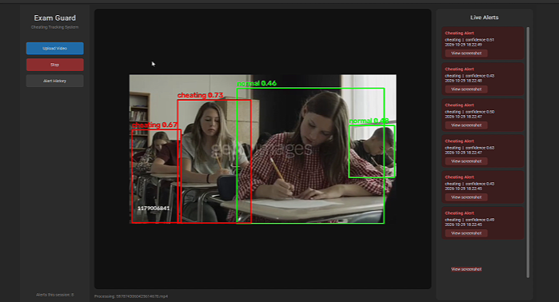

# 🎓 Exam Guard: Cheating Tracking and Alert System


A desktop AI application that watches **exam videos**, detects suspicious behavior, tracks every student, and raises an alert with a screenshot when cheating is detected. Every alert is saved to a database so it can be reviewed later.

> ⚠️ This is a student project. It only **flags** suspicious moments for a human to review. It must not be used to accuse a student on its own.

---

## 🌐 Links

- 📓 **Training notebook on Kaggle:** [cheating-detection-training](https://www.kaggle.com/code/abdelazizelshourbgy/cheating-detection-training/notebook)

## 📸 Demo

<!-- Put your own screenshots in assets/ and keep the names below -->


---

## ✨ Features

- Detects two classes, **normal** (green box) and **cheating** (red box)
- Tracks each student with **ByteTrack**, so every student keeps the same ID (`#3 cheating 0.86`)
- Smart alerts to avoid spam: an alert is raised only when
  - confidence is at least **0.6**,
  - the behavior lasts **8 frames in a row**, and
  - the same student has not triggered an alert in the last **5 seconds**
- Automatically saves a **screenshot** (with the red box drawn) in `alerts/screenshots`
- Saves each alert in **SQLite** (`alerts.db`): date/time, behavior, confidence, screenshot path
- Optional **Firebase**: Firestore for alert records and Storage for screenshots
- Instant **pop-up notification**, for example: *Cheating Alert Detected, Behavior: cheating, Time: 10:35 AM, Screenshot saved successfully.*
- **Live Alerts** panel and an **Alert History** window, where you can open any saved screenshot

## 🗂️ Dataset

Custom dataset on Roboflow (project `exam-malpractice-detection2`, version 2), exported in YOLOv8 format.

| Split | Images |
|---|---|
| Train | 636 |
| Validation | 182 |
| Test | 91 |

The test set contains 620 boxes: 264 `cheating` and 356 `normal`.

---

## 🧠 Model and training

| Setting | Value |
|---|---|
| Model | YOLO11s (9.4M parameters, about 19 MB) |
| Epochs | 50 |
| Image size | 960 (phones and small movements are small objects) |
| Batch | 16 |
| Seed | 42 |
| Hardware | Tesla T4, about 17 minutes |

## 📊 Results

### Test set (best weights)

| Metric | Value |
|---|---|
| mAP50 | 0.826 |
| mAP50-95 | 0.555 |
| Precision | 0.750 |
| Recall | 0.767 |

| Class | Precision | Recall | mAP50 | mAP50-95 |
|---|---|---|---|---|
| cheating | 0.766 | 0.712 | 0.795 | 0.510 |
| normal | 0.734 | 0.823 | 0.856 | 0.599 |

On the validation set the final model reached mAP50 0.840 and mAP50-95 0.573.

- `cheating` is the harder class: lower recall (0.71), so roughly 3 in 10 cheating boxes are missed in a single frame. The tracking and the 8-frame rule help because the behavior usually lasts many frames.
- The test set is small (91 images), so these numbers can move a lot with a different split. The model was trained once.

<!-- Add your confusion matrix:  -->

---

## 📁 Project structure

```
cheating-detection/
├── app.py                              # Tkinter desktop app
├── best.pt                             # trained YOLO11s weights
├── cheating-detection-training.ipynb   # training and evaluation notebook
├── requirements.txt
├── assets/                             # screenshots
├── alerts/screenshots/                 # created automatically (ignored by git)
├── alerts.db                           # created automatically (ignored by git)
└── README.md
```

## 🚀 Run locally

```bash
git clone https://github.com/<your-username>/cheating-detection.git
cd cheating-detection

python -m venv venv
venv\Scripts\activate        # Windows
# source venv/bin/activate   # macOS / Linux

pip install -r requirements.txt
python app.py
```

Then click **Upload Video**, choose an exam video, and watch the detections and alerts.

### Settings (top of `app.py`)

| Name | Default | Meaning |
|---|---|---|
| `CONF` | 0.4 | minimum confidence to draw a box |
| `ALERT_CONF` | 0.6 | minimum confidence to raise an alert |
| `ALERT_FRAMES` | 8 | cheating frames in a row before an alert |
| `COOLDOWN_SECONDS` | 5 | wait time before repeating an alert for the same student |
| `IMAGE_SIZE` | 960 | inference size, keep it equal to the training size |
| `USE_FIREBASE` | False | also save alerts to Firebase |

### Enable Firebase (optional)

1. Create a Firebase project and enable **Firestore** and **Storage**.
2. Download a service account key, save it as `serviceAccountKey.json` next to `app.py`.
3. Set `FIREBASE_BUCKET` to your bucket name and `USE_FIREBASE = True`.

**Never commit `serviceAccountKey.json` or your Roboflow API key.** Both are already covered by `.gitignore` or Kaggle Secrets.

## 🔁 Reproduce the training

Open the notebook on Kaggle with a GPU, add your Roboflow API key as a Kaggle Secret named `ROBOFLOW_API_KEY`, and run all cells. Download `best.pt` from the Output tab.

## ⚠️ Limitations

- Small dataset (909 images) and a small test set. Results may not hold on new classrooms, cameras, or angles.
- The model detects visual cues that were labeled as cheating. It cannot know the real intent of a student, so false alarms are possible and every alert needs human review.
- ByteTrack can swap IDs when students overlap or leave the frame.
- Detection runs in the same thread as the interface, so the window can feel slow on a CPU-only computer.
- If frames from the same video appear in more than one split, the scores can be too optimistic (not verified).

## 🔮 Future work

- Run the model in a background thread for a smoother interface
- More data from different rooms and cameras
- Add more behavior classes (phone, looking at a neighbor, passing papers) instead of a single `cheating` class
- Live camera input in addition to uploaded videos
- Export alert reports to PDF or CSV

## 🛠️ Tech stack

Python · Ultralytics YOLO · ByteTrack · OpenCV · CustomTkinter · SQLite · Firebase · Roboflow · Kaggle

## 👤 Author

**Abdelaziz Elshourbgy**

GitHub: [@AbdelazizElshourbgy-ui](https://github.com/AbdelazizElshourbgy-ui) · LinkedIn: [Abdelaziz Elshourbgy](https://www.linkedin.com/in/abdelaziz-elshourbgy-b126a83a2/)

## 📄 License

Code released under the [MIT License](LICENSE).
